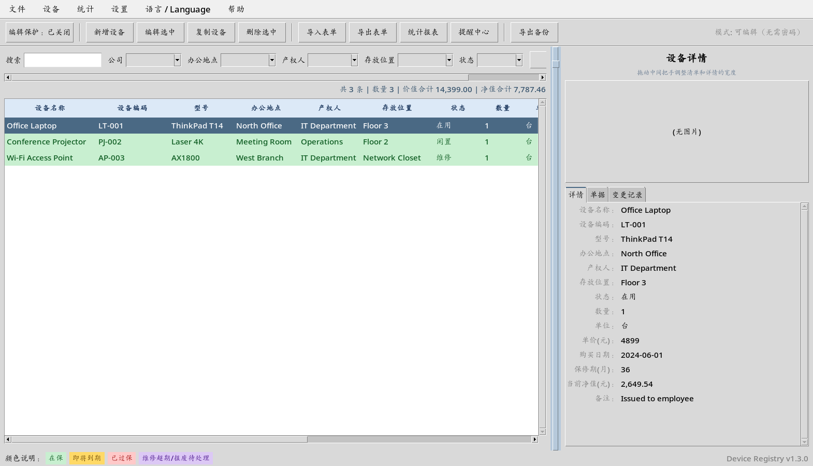

# Device Registry｜设备资产管理工具

**免费开源 · 本地离线 · 中文 / English**

一款面向个人、学校及中小团队的 Windows 设备资产管理工具。基于 Python、Tkinter 和 SQLite，无需注册账号，也无需服务器。



## 主要功能

- **资产管理**：新增、编辑、复制和查询设备；固定 14 列清单，支持拖动调整清单与详情宽度。
- **实用记录**：设备图片、采购单据、操作日志、保修提醒及折旧统计。
- **数据导入导出**：Excel / CSV、ZIP 备份与恢复。
- **使用灵活**：中英文界面切换；编辑密码保护可自行开启或关闭。

## 下载与运行

**Windows：** 正式版发布后，可从 [Releases](https://github.com/Josun6/device-registry/releases) 下载 `DeviceRegistry.exe`。当前也可以直接运行源码：

```bash
python -m pip install -r requirements.txt
python device_registry.py
```

也可以在 Windows 双击 `run.bat`。设备数据保存在本地，请定期备份。**编辑密码不等于数据库加密。**

使用问题或功能建议：[GitHub Issues](https://github.com/Josun6/device-registry/issues) · [中文使用指南](docs/USER_GUIDE.md)

## English

**Device Registry** is a free, offline desktop asset manager for Windows, built with Python, Tkinter and SQLite. No account or server required.

- Manage and search devices, with a fixed asset list and resizable details panel.
- Track photos, documents, warranties, depreciation and activity history.
- Import/export Excel or CSV files, and back up or restore with ZIP.
- Switch between Chinese and English; optional editing password.

Download `DeviceRegistry.exe` from [Releases](https://github.com/Josun6/device-registry/releases) once published, or run the Python source using the commands above. Data is stored locally; **the editing password does not encrypt the database**.

Support: [GitHub Issues](https://github.com/Josun6/device-registry/issues).

**License / 开源协议：** [MIT](LICENSE) · Copyright © 2026 sunly56

## ☕ 打赏 · 请我喝杯咖啡 | Buy Me a Coffee

如果这个免费工具对你有帮助，欢迎通过微信请我喝杯咖啡，支持持续维护。**完全自愿，不影响任何功能。**

If this free tool is useful to you, you can buy me a coffee via WeChat. Donations are entirely optional.


