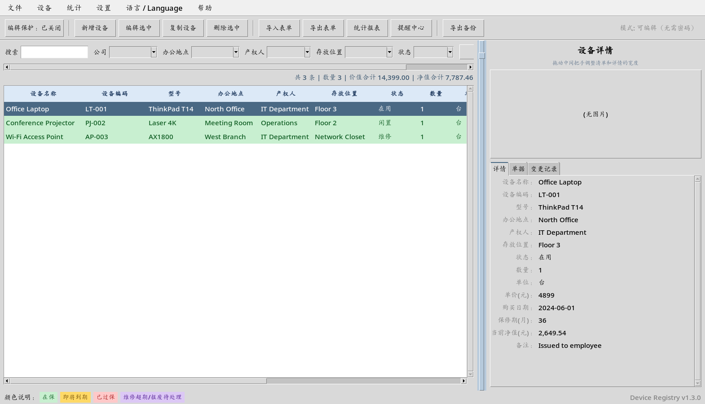

# Device Registry

**Free, local-first asset inventory for small teams.** A desktop app built with Python, Tkinter and SQLite. It requires no account, server or cloud service and supports Simplified Chinese and English.

[中文说明](README.md) · [User guide (Chinese)](docs/USER_GUIDE.md) · [Changelog](CHANGELOG.md) · [Donations](DONATE.md)




> **Version 1.3.0.** Licensed under the [MIT License](LICENSE). Copyright holder: **sunly56**. Confirm your right to distribute the source, icon and other assets. Donations are optional.

## Features

- **Fixed 14-column asset list:** Device Name, Asset Code, Model, Office, Owner, Location, Status, Quantity, Unit, Unit Price (CNY), Purchase Date, Warranty (Months), Current Net Value (CNY), and Notes. There is no longer a field-visibility editor.
- **Straightforward form:** Edit the corresponding stored fields and optionally attach a photo. Net value is calculated from depreciation rules, not entered manually.
- **Asset operations:** Add, edit, duplicate and delete; case-insensitive asset code checks; batch duplication.
- **Search and filters:** Company, office, owner, location and status filters stay on one line. A horizontal scrollbar keeps them accessible in narrow windows.
- **Resizable layout:** Drag the handle between the list and details. The sash position is saved; list column widths adapt to available space while horizontal scrolling remains available.
- **Bilingual UI:** Switch Chinese/English instantly using `Language`. Stored status values retain their original format.
- **Optional editing password:** New databases are editable by default. Password protection can be enabled explicitly; old password-protected databases remain protected. The password **does not encrypt data**.
- **Additional tools:** Images, procurement documents, activity history, depreciation and warranty reminders, reports, Excel/CSV import and export, and ZIP backup/restore.

### Compatibility with older data

Legacy database fields (including Company and Status Date) are preserved even when omitted from the fixed view. Older field-visibility preferences are ignored. Specify a default company under `Settings → Default Company & Alerts`; if only one company exists, new records will use it automatically.

CSV/Excel exports intentionally retain the **full data schema**, so exported files contain more columns than the fixed on-screen list.

## Run from source

Requirements: **Python 3.9+** with Tkinter. On Windows, you can double-click `run.bat` or run:

```bash
python device_registry.py
```

The standard-library-only core works without third-party dependencies. Install optional Excel and image support with:

```bash
python -m pip install -r requirements.txt
python device_registry.py
```

Data is saved alongside the application in `devices.db`, `images/`, and `attachments/`. Run it from a folder where you have write permission, rather than `Program Files`.

## Getting started

1. Launch the app and select `Add Device`. New databases do not require a password.
2. Enter a device name and unique code. Purchase Date defaults to today; Quantity defaults to 1.
3. Select a saved device to inspect its details and photo. Use the `Documents` tab to add invoices or contracts.
4. Drag the divider between asset list and details to resize the panes; scroll the list horizontally to see additional columns.
5. Optionally enable editing password protection under `Settings → Editing Protection Settings` or set default company and reminders under `Settings → Default Company & Alerts`.
6. Create periodic ZIP backups using `File → Export Backup`.

## Windows builds

Only the **standard Windows edition** is published. Run `build_exe.bat` to create `DeviceRegistry.exe`, including Excel and Pillow image support. No Lite edition is built or released.

The build script uses an isolated virtual environment and embeds `assets/icon.ico` and `assets/icon.png`. The final EXE size, taskbar icon appearance and startup performance **have not been measured on a Windows machine in this environment**. GitHub Actions builds and releases only `DeviceRegistry.exe`; see [build instructions](docs/BUILD_AND_RELEASE.md).

## Tests

```bash
python -m pip install -r requirements-dev.txt
xvfb-run -a python -m pytest -q tests/  # Linux graphical tests
python -m pytest -q tests/test_core.py   # Headless/core tests
```

**42 automated tests passed** in a Linux virtual display, covering the fixed list, bilingual UI, password options, legacy database migration, attachment handling, path checks, and backup rollback. Migration was also checked against a copy of an older supplied SQLite database without modifying the original. **Windows 10/11, high DPI, multiple monitors and produced EXEs still need real-machine acceptance tests.** Passing tests cannot guarantee the absence of all defects.

## Privacy, licensing and support

Data stays local by default, and this app has no built-in telemetry. Editing protection is not database encryption. **Do not commit real `devices.db` files, photos, invoices, contracts or backups to a public repository.** See [Privacy](PRIVACY.md) and [Security](SECURITY.md).

Please review the [publishing checklist](docs/PUBLISH_CHECKLIST.md) before publishing. Before committing, enable GitHub's email privacy setting under `Settings → Emails` to prevent your personal email from appearing in commit metadata. The MIT [LICENSE](LICENSE) contains only the copyright name; no personal email address is published. Please use GitHub Issues for support (see [SUPPORT.md](SUPPORT.md)). Donations are voluntary; see [DONATE.md](DONATE.md). The repository now includes a public WeChat donation QR code.
